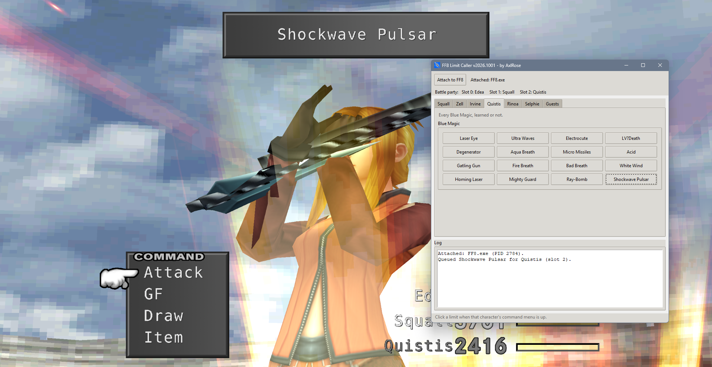

# FF8 Limit Caller

FF8 Limit Caller lets you call any Limit Break in Final Fantasy VIII right on that character's turn, learned or not. It's made for modders working on limit breaks, like their voices, sound effects, music or models, so you can trigger every limit and every variation of it whenever you need to, instead of playing until you get it.

It covers every party member: Squall's Renzokuken ending in any finisher, Zell's Duel moves and finishers, all of Irvine's shots, all 16 of Quistis' Blue Magic, Rinoa's Combine moves, Angel Wing and Angelo on his own, any spell through Selphie's Slot (Full-Cure, Wall, Rapture and The End included), and the guest limits for Seifer, Edea, Laguna, Kiros and Ward when they're in your party.

It's a testing tool for modders, not a trainer. When you click a limit, it writes it into the game's list of pending battle actions, the same way the battle menu does, and the game runs it on that character's turn. To make the limit come out the way you picked, it also sets a few values the game checks while the limit plays, like the crisis level, Squall's finisher roll and Zell's next Duel move. Anything it changes that the game would keep, like Squall's weapon or which shots and Slot spells you've used, is put back right after.

It pairs well with the other tools: [FF8 Battle Teleport](https://github.com/AxlRose-RX/FF8-Battle-Teleport) to jump into the battle you want, [FF8 Audio Monitor](https://github.com/AxlRose-RX/FF8-Audio-Monitor) to see which voice and sound files the limit plays, and [FF8 Summon Caller](https://github.com/AxlRose-RX/FF8-Summon-Caller) for summons.

It has only been tested with FFNx and the Junction VIII mod manager, on Final Fantasy VIII Remastered and the original 2013 Steam version, and those are the only setups it supports.

## Download

Get `ff8_limit_caller.zip` from the [latest release](https://github.com/AxlRose-RX/FF8-Limit-Caller/releases/latest), unzip it anywhere and run `ff8_limit_caller.exe`. Keep the `_internal` folder next to the .exe.

Because it writes to the game's memory, some antivirus programs may flag it. The full source is here if you want to check it or build it yourself.

## How to use

1. Start the game through Junction VIII and get into a battle with the character you want.
2. Click **Attach to FF8**.
3. Open that character's tab.
4. When their command menu is up, click a limit. The tool finds which slot the character is in on its own.

## Build it yourself

Download **Source code (zip)** from any release, install [Python 3](https://www.python.org/downloads/) and double-click `build_exeonedir.bat`. It installs everything it needs and builds the app into `dist\ff8_limit_caller`.

## Credits

Made by AxlRose. Claude (Anthropic's AI) helped write the code.

Questions and bug reports: [Tsunamods Discord](https://discord.com/invite/7Rsvsewghz)
